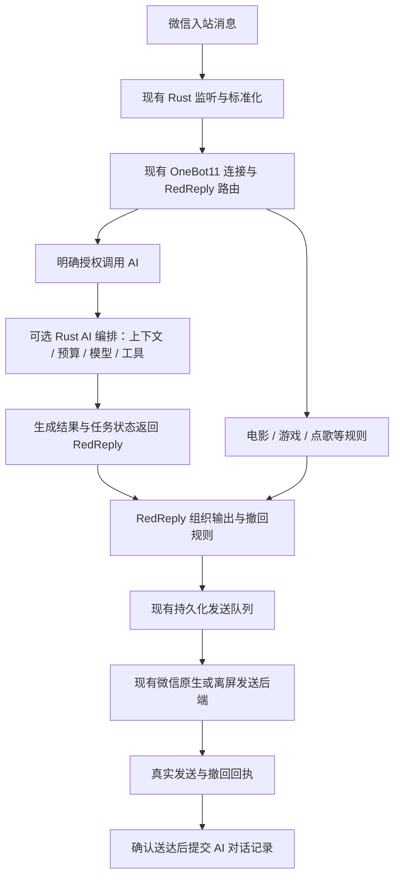

# whale_gril 功能引入与微信 · RedReply 项目对比报告

调研日期：2026 年 11 月 6 日。

**建议引入 whale_gril 的 AI 产品能力，保留现有 Rust 微信传输、OneBot11 接入和 RedReply 业务路由。** 重点是多模型接入、上下文与长期记忆、群聊触发、识图、语音转写和可控联网；不建议整体替换当前微信后端，或直接搬入鲸鱼娘的人格与录音发送流程。

本文只分析与提出方案，没有修改程序源码、配置、部署或运行中的微信，没有调用模型，也没有运行上游程序、测试或安装器。

## 1. 对比基线与证据范围

| 项目 | 固定快照 | 说明 |
| --- | --- | --- |
| 当前项目 `nodesire7/wechat-redreply` | `dd1d15ad05c9d258fef10190a3f706845c08edf7`，v0.2.3 | 本地 HEAD 与 GitHub main 一致；核查 Rust 源码、兼容说明和已有验收边界。[C01] |
| 参考项目 `Banan1cee/whale_gril` | `d788f121d9b91758177d8b1850904cd9b139c831`，4.0.5 | GitHub 获取固定提交；同一提交源码归档只读解压到系统临时目录进行检索。[W01] |

证据分为三类：**源码确认**表示存在实际调用路径；**项目声明**表示来自 README、说明或注释；**分析建议/风险推断**不表示已经实现或运行复现。上游网页缓存仍有 3.9 内容，固定快照的部分文档也落后于代码，因此不以宣传页代替源码判断。

本次没有进行两套软件的同机压力测试、真实模型调用、微信实机对照或长期挂载验证。不能由语言、模块数量、测试数量或“微信 4.x”字样推导其速度、稳定性和版本兼容性一定更好。

当前项目是微信传输与 RedReply 兼容层；它的电影、游戏、运势等业务来自 RedReply 插件。下文“当前未内置 AI”指 Rust 项目本体，不等于断言 RedReply 生态或你服务器上的其他插件没有 AI 能力。[C02][C03]

whale_gril 是独立聊天应用，其 webhook、启动器 API 和内部平台适配不是 OneBot11；不能把其功能数量视为我们的 OneBot 动作覆盖率。

## 2. 结论与取舍

| 方向 | 建议 | 理由 |
| --- | --- | --- |
| 多模型与自定义接口 | **第一批引入** | 上游已有完整 provider 配置、请求构造、错误分类、参数适配与用量读取，明显补足当前 Rust 本体没有 AI 引擎的部分。[W02][W03] |
| 上下文、长期记忆、群聊续聊 | **引入设计，按当前业务重做边界** | 人物卡、摘要、事件检索和群成员上下文值得借鉴，但必须适配账号隔离、RedReply 路由和真实送达状态。[W04][W05][W06] |
| 识图、ASR、TTS 生成 | **分开引入** | 三者的协议、密钥、输入与失败方式不同。已有“发送原生语音”并不等于已有 ASR 或 TTS。[W07][W08][W09][C04] |
| 微信发送、音乐卡、整条输出撤回 | **保留当前实现** | 上游未展示等价的 OneBot 输出回执、原生音乐生成和按输出拆分消息统一撤回链路；其默认回退还可能触碰前台和剪贴板。[C02][W10][W11] |
| 并发与积压处理 | **借鉴会话调度，保留持久化语义** | 上游按会话串行、跨会话并发有价值；但有丢弃最旧消息的容量策略，不能替代当前用户要求的持久化排队。[W12][C05] |
| 长期运行诊断 | **值得增强** | 阶段心跳、堆栈、明确停止标记和有上限的自动重启，比只看进程存活更有用；不能照搬强制退出或无限恢复。[W13][W14] |
| GUI 与升级 | **借鉴功能组织，不更换技术栈** | 增加实际 AI 设置、测试、用量和记忆管理；保留现有 B 布局、红白绿与明暗主题。无需引入 Node、Python、.NET 运行链。[W15][C06] |

引入后应该得到的是“现有微信 · RedReply 工具增加可选 AI 能力”，而不是同时跑两套监听、两套微信发送程序、两套会抢同一输入框的机器人。

## 3. AI 能力逐项核查

### 3.1 模型接入：已有可借鉴的真实实现

上游当前配置有 `deepseek`、`zhipu`、`siliconflow`、`qwen`、`tju`、`ollama`、`custom`、`opencode` 八个预设。主要共用 OpenAI Chat Completions 兼容请求；支持自定义地址、模型名、按 provider 保存 Key，以及本地/内网模型的免 Key 路径。[W02][W03]

| 能力 | 上游实际情况 | 在当前项目中的建议 |
| --- | --- | --- |
| 服务商预设 | 按 provider 选择 base URL、模型和已保存的凭据 | 预设提供便利，底层统一接口；本地模型地址可显式允许 LAN/loopback。 |
| 自定义模型接口 | 自动补全聊天路径，本地 404 可尝试有/无 `/v1` | 提供明确的“接口类型”和连接测试；路径适配应有记录，避免悄悄调用错误地址。 |
| 不同模型参数 | 处理 thinking、reasoning、输出 token 字段及部分 400/422 参数降级 | 用能力描述管理参数；不能只按模型名字猜测，更不能承诺所有新模型自动兼容。 |
| 非流式响应 | 有大小限制、错误体识别、空输出/截断处理，区分 reasoning 与回答 | 借鉴结构化错误和答案提取；生成重试与微信发送重试必须分开。 |
| 流式输出 | 有 SSE 路径，但与非流式的过滤、降级和重试能力不完全一致 | GUI 可显示生成进度；发微信前先完成必要校验，避免每个 token 变成一条微信消息。 |
| 用量 | 解析多种 token/cache usage 字段 | 按 request、会话、provider 和模型归属；统计聊天、摘要、搜索路由、ASR/TTS 等辅助调用。 |

这些预设不等于实现了各厂商原生 SDK。源码没有因此获得原生 Anthropic Messages、Gemini 协议或通用 Responses 服务端能力。先实现稳定的 OpenAI 兼容入口，再按实际需要增加协议适配。[W03]

有三项需要改得比上游更严格：

1. **备用供应商必须预先授权。** 上游部分错误会触发自动换到另一家已存 Key 的服务，并持久改写 provider，再把同一段历史发过去。这会改变数据外发对象。当前项目应使用显式备用清单、可关闭策略和可见切换记录，不因保存过 Key 就自动取得跨供应商外发授权。[W16]
2. **推理必须有共同 deadline 和并发预算。** 上游普通聊天未形成统一的 provider 并发信号量、RPM/TPM 调度、整轮 deadline 或费用硬限。单个 HTTP 的超时、回复条数上限，不能限制一轮里叠加的重试、摘要和工具模型调用。[W03][W17]
3. **不要直接照搬共享 usage 归集。** 上游跨会话调用可并发，但部分用量按共享 client 的序号区间归集。静态分析存在把其他调用计入本轮的风险；本次未运行复现。应从一开始按独立请求 ID 归因。[W18]

### 3.2 上下文与记忆：最有价值的第二层能力

上游不仅把最近几条文本拼进 prompt。它按 chat 保存历史、人物卡、摘要、episode 和事件，使用 BM25 与 MMR 检索相关记忆，再分配上下文预算；有备份、迁移、归档与容量控制。这比当前传输层的“近期对话展示”更适合长期 AI 对话。[W04][W05][W19]

但它不是通用向量知识库，也不能据此宣称已经支持上传文档、PDF RAG 或 embedding 检索。

建议分两批引入：

- **第一批：短期上下文。** 按机器人账号、平台、私聊/群聊、会话和成员身份隔离；保留群成员、时间、消息来源。不能用显示昵称作为唯一身份，重命名也不应丢记忆或串人。
- **第二批：可追溯长期记忆。** 人物事实、摘要和事件带来源消息、归属、置信度和时间；支持查看、纠正、遗忘、过期与加密导出。未确定归属的事实不写入某个人的永久卡片。

两点应优于上游：

**事实归属不能靠“最后一个说话人”补齐。** 上游 episode 抽取发现缺失/无效 UID 时，可将条目归给最后发言者；在多人群聊里有长期误记风险。应丢弃或进入待确认区，不强行认领。[W20]

**生成过的回答不能直接当作已经送达。** 上游 finalize 会先把 assistant 文本写入记忆，再把结果交给桥接发送。我们已有真实发送回执，应把“草稿/生成结果”和“已送达对话”分开；发送失败或待核对时，不让 AI 在后续对话中断言“我刚才已经告诉你了”。[W21][C05]

存储建议是在现有数据目录内为 AI 记忆建立独立存储边界，避免把大 prompt、媒体和历史全文再次混进高频扫描的发送/撤回表。所有自动摘要与抽取都应计入同一套模型预算。

### 3.3 群聊触发：能借鉴，但要服从 RedReply 路由

上游实现了 @、名字唤醒、回复机器人、续聊窗口、静默、冷却和主动插话策略。群上下文按发言人事件组织，优于把多个群友的话合并为一个 user 段。[W06][W22]

需要注意：上游 `requireAt=true` 仍有主人、问号、定向叫说话等例外，不代表绝对只回复原生 @。其角色聊天策略不宜直接作为当前项目默认行为。[W06]

建议默认提供三种清楚的规则：**明确指令调用 AI、群内明确唤醒、同一说话人的短续聊**。主动插话另设开关，默认关闭。电影、游戏、点歌等现有 RedReply 插件的优先级与权限保持原有约定。

当前 Rust 入站事件还缺少完整多模态和结构化引用/@ 元数据。现有数据库循环主要只发布 `kind == 1` 的文本消息，不能以“已经能发送图片和语音”推导 AI 已经能理解收到的图片、语音和原生 @。[C07]

### 3.4 识图、语音转写与语音回复必须分层

| 项目 | whale_gril 实现 | 当前状态与引入方式 |
| --- | --- | --- |
| 图片理解 | 独立视觉请求，把图片和提示发送给视觉模型，结果转为文字描述 | 当前尚无完整入站图片供 AI 的链路。先补消息类型、媒体读取与归属，再加独立 Vision profile。[W07][C07] |
| 语音转写 ASR | 微信缓存语音解码成 WAV，再按 DashScope 专用协议请求转写 | 当前原生语音能力主要是出站。ASR 不能直接把普通聊天 base URL 拿来使用，需要独立适配。[W08][W42][C04] |
| 文字转语音 TTS | 已有 BreezeBlue 云 TTS；README“自己只发文字”落后于实现 | 可借鉴 TTS 配置与生成状态，但音频生成后交给我们现有 SILK/CGI127 原生发送链路。[W09][C04] |
| 微信语音发送 | 上游自动语音使用虚拟声卡、微信录音快捷键和前台窗口 | 不采用这条传输路线；它会调用 `SetForegroundWindow` 和 `SendInput`，与现有要求冲突。[W23][W49] |
| 表情包 | 分类图库、模型标签、概率、严肃场景抑制、实验发送确认 | 可引入图库与选择策略；发送后端重新适配。当前 GIF/WebP 等会归一化 PNG，不能直接承诺动画表情已支持。[W24][W39][C08] |

聊天、视觉、ASR、TTS 应分别描述能力与授权。上游聊天本地免 Key，不代表 ASR 也支持同样的本地接口；Breeze 的接口也不是普通 Chat Completions。[W02][W08][W09]

### 3.5 联网与工具：适合做可控的补充能力

上游有搜索路由、天气、热榜和链接正文抓取，但本质上是程序固定编排，不是任意 function-calling agent。其过滤、总预算和外部资料标签值得借鉴；站点 HTML 和公开接口变化仍会造成维护成本。[W25][W50]

建议把“联网搜索/读取链接”与“调用现有电影、游戏、点歌插件”分开：已有业务继续由 RedReply 处理；AI 工具只调用明确允许的能力，并返回来源和失败状态。搜索失败不应被回答成已查证事实。

用户发来的链接抓取要有私网、重定向、大小及 DNS 检查；这与用户主动配置的 Ollama/LAN 模型地址是两种权限边界，不能为了防 SSRF 一刀切禁止本地模型，也不能为了支持本地模型放开任意私网抓取。[W26]

## 4. 现有微信功能有没有更好的实现

### 4.1 接收与调度

两边都依赖微信本地数据库读取，whale_gril 并没有提供一个可直接取代现有实现的官方微信推送协议。上游 Listener 轮询与多个判定 worker 分离；我们的数据库/WAL 接收也已独立于发送线程，并保存游标。[W27][C07]

**值得借鉴：同会话推理串行、跨会话有界并发。** 这能防止某个会话的长识图/模型请求卡住其他会话。但它解决的是 AI 判定调度，不代表能并行操纵同一个微信输入框。原生发送仍应统一串行。[W12]

**不能照搬：超限丢最旧的队列。** 上游 `MessageBatches` 和 `MessagePipeline` 都有达到容量后 `pop(0)` 的路径，属于面向聊天时效的取舍。当前用户明确要求积压保留与跨重启排队，应保留持久化原事件与任务；即便把连续短句合并成一次 AI 请求，也不能删除原始消息或破坏现有指令、序号选择和撤回范围。[W12][C05][C15]

### 4.2 文字发送与送达确认

| 维度 | 当前 Rust 项目 | whale_gril | 判断 |
| --- | --- | --- | --- |
| 输入方式 | UIA 设置完整文本并定向操作，保留草稿恢复 | 后台通道逐个投递 WM_CHAR，处理 UTF-16/GBK；失败有多级回退 | 可研究兼容细节，不应整体替换。[C09][W28] |
| 后台失败后的动作 | 以不抢全局操作为约束，不能确认则报失败/待核对 | 默认可回退到前台、键盘或 OCR；`fallbackToForeground=false` 可限制部分文本路径 | 上游默认行为不满足我们的完整要求。[W10][W11] |
| 成功证据 | 数据库服务器消息编号或受支持原生网络回执 | 普通后台文字可按输入框清空判断；读不到输入框时返回 `sent_unverified` | 我们的确认边界更适合当前业务。[C05][W29] |
| 结果未知 | 保留“待核对”，不盲目重发 | 后台通道、旧 UIA 回退、实验表情发送的语义不完全一致 | 统一沿用我们的发送状态机。[C15] |

上游默认 `charGapMs=40`，逐字投递会带来与文本长度相关的固定等待；这可从代码推导，但本次没有实测吞吐，不能写成“Rust 快多少倍”。输入框清空也不能等同于收件端收到消息。[W28][W29]

上游的实验表情包链路更严格，会核对新本人图片记录、歧义和发送后状态，不盲目重发。这些检查思想值得借鉴，但我们已经有图片指纹、目标/账号/时间关联和迟到 ACK 处理，宜互补审查，不应替换成剪贴板粘贴路线。[W24][W51][C10]

### 4.3 原生音乐、撤回与合并转发

| 功能 | 对比结论 | 建议 |
| --- | --- | --- |
| QQ 音乐转微信原生音乐卡 | 当前已有本次曲目元数据、QQ songmid、原生 type3 与网络回执。上游主桥接未找到等价的新建音乐卡动作；媒体解析不等于音乐卡生成。[C11] | 保留当前。AI 可以决定调用现有点歌能力，不负责伪造音乐 XML 或解除音源授权限制。 |
| 原生语音气泡 | 当前有指定微信版本的 CGI127/SILK 路线；上游 TTS 生成有价值，但发送用录音/声卡/前台。[C04][W23] | 引入生成层，保留当前发送层。 |
| 同一输出拆分消息统一撤回 | 当前已有输出 ID、每个物理消息真实回执、120秒上限与持久化撤回计划。上游没有展示同等的 OneBot 输出级契约。[C02][C05] | 保留当前，不把一轮 AI 的所有输出无条件绑为同一撤回计划。 |
| 合并转发 | 当前可把完整 node 通过本账号自聊转成 type19，并核对内容。上游 vendor 有普通转发接口，但不等于桥接业务已实现这套任意节点合并卡。[C02][W30] | 保留当前；不因 AI 引入重做已正常工作的合并转发。 |
| 主动撤回 vs 防撤回 | 上游 `recall.py` 的 RecallGuard 主要是撤回事件镜像/保留；另有 `recall_last_message` UIA 方法 | 二者不能当作我们主动撤回指定输出的替代品。[W46][W47] |
| 原生 @ 与引用 | 上游存在 `send_at`、`quote_msg` 使用路径；当前 @ 为可读正文、reply 为追踪 | 这是值得补齐的差距，但要另做不抢前台、不用剪贴板、严格核对成员与目标的发送后端；上游默认路径不直接达标。[W10][W31][C02] |
| 文件与视频 | vendor 中有文件发送等方法，未形成可直接接入我们的 OneBot 通用动作层 | 可做后续专项，不把 vendor 的接口目录等同于产品已经支持。[W48][C02] |

### 4.4 全程隐藏、账号身份与客户端版本

上游“后台发送”与我们要求的“全程离屏、不得抢焦点/鼠标/剪贴板”不是同一个保证：

- 后台文字有专用路径，但 `engine.py` 仍存在前台切换、键盘、剪贴板和 OCR 回退；引用与自动语音有独立路径，不能只关闭一个文本 fallback 开关就宣称全部发送无干扰。[W10][W11][W23]
- 上游账号为空时有自动选最近活跃账号的设计。当前项目应保留明确绑定、PID/创建时间/窗口和账号身份校验，不在恢复时猜测另一个账号。[W32][C12]
- 上游 README 的“不读内存”表述不宜照搬。实际数据库依赖读取进程内存取密钥；`uia_boot` 在需要时会读写微信 UIA gate 字节。**不注入 DLL、读取数据库、读取进程内存、修改运行时 gate 是不同概念。** 本次不据此给出账号安全或全版本兼容承诺。[W33][W43][W44]
- 我们的原生音乐、语音和撤回也有严格版本条件；尤其原生语音目前限已核对的 4.2.0.12。引入 whale_gril 不会自动扩大到所有微信版本。[C04][C11]

### 4.5 长时间挂载：可借鉴的重点是可观测性和有界恢复

上游有发送阶段状态、卡死堆栈、桥接心跳、停止标记与有限重启计数；启动器会抑制短时间反复崩溃，也会尊重 `PAUSED`。这些值得纳入当前长期运行设计。[W13][W14]

建议增加以下能力，作为 v0.2.3 已有窗口限时检查、消息查询缓存和撤回索引的补充：[C13]

| 改进 | 具体要求 |
| --- | --- |
| 分阶段心跳 | 分清数据库读取、AI 排队、推理、原生发送、等待 ACK、撤回；“进程在”不代表这些阶段在前进。 |
| 超时证据 | 先记录任务 ID、阶段、耗时、资源和必要堆栈，避开 Key、签名 URL 与完整 prompt；不要靠反复重新初始化窗口“碰运气”。 |
| 有界恢复 | 只恢复本程序有确切身份的进程；设置次数上限、退避、停止原因和手动停止标记；不自动关闭用户微信或重选账号。 |
| 不确定提交 | 微信提交后没有回执，保持 uncertain；重启不能把它当未发送再执行。 |
| 索引与缓存验收 | 真实历史图片/音频积累后检查查询计划、读取量和内存上限；不能只在空数据库测压。 |

WPF、Node 或 Python 本身不能证明更少白屏；Rust 本身也不能证明没有死锁。上游同样有 UIA、OCR 卡住及恢复处理的代码。此前观察到的 Windows DWM 故障仍是独立环境因素，不能用“换一套 GUI”代替故障验证。

### 4.6 其他业务能力的实际边界

- **提醒与主动关怀：**上游提醒有领取、回执、过期和取消状态，可借鉴产品流程；发送回执超时的重试仍要服从我们的 uncertain 边界。主动关怀会产生新的对外消息，应有明确对象、静默时段与次数上限，默认不向群和其他联系人自动扩散。[W52][W59]
- **群“禁言”：**上游相关命令主要是暂停机器人在某会话回答，不等于微信管理员禁止群成员发言，不能因此把我们的 `set_group_ban` 标成已支持。[W53][C02]
- **其他平台：**上游有微信/抖音 webhook 归一化入口，不等于已经具有相应客户端的监听后端，更不能直接用来补全 OneBot11。朋友圈等 vendor/文档能力也应单列专项，不并入本轮 AI 最小交付范围。[W54]

## 5. 推荐的集成架构

### 5.1 三条路线的取舍

| 路线 | 优点 | 代价 | 建议 |
| --- | --- | --- | --- |
| 整套 whale_gril 与当前工具并行 | 源码层面最快获得完整角色聊天能力 | 多套运行时、监听与发送主体；路由冲突；前台/剪贴板约束不一致 | 不作为正式交付路线。 |
| 在 RedReply 内编写独立 AI 插件 | 保持现有业务入口，桥接改动少 | AI 配置/记忆可能与当前 GUI 分离；多模态输入仍需补齐 | 适合作为小范围验证或最小方案。 |
| **保留 RedReply 路由，在 Rust EXE 内新增可选 AI 编排能力** | 保持单 EXE 的运行目标、现有队列与原生媒体能力；配置可落当前 GUI | 需要把上游通用 AI、记忆与工具设计移植为 Rust 模块，并定义异步契约 | **推荐正式方向。** |

“新增 Rust AI 能力”是本报告的方案建议，当前 v0.2.3 没有这些模块或接口。

### 5.2 RedReply 继续决定由谁处理消息

建议流程如下，**这是架构示意，不是已实现链路**：

优先研究经现有 OneBot 连接的显式扩展动作提交/查询 AI 任务，避免新增第二个控制端和额外对外端口。当前程序只允许一个 OneBot 控制连接，不能让 AI 服务再占用另一个连接。若最终选择 HTTP 边界，则需要独立鉴权、部署地址与 TLS 设计；不能直接把 whale_gril 的 `8787` 当作我们的 OneBot 端点。[C14][W34]

尤其不能使用以下判断：“若 2 秒/30 秒没有插件回复，就认定无人处理，交给 AI。”电影、游戏等插件有异步步骤，这会制造重复回复和交错撤回。应由 RedReply 明确调用 AI，或以互斥的命令/会话模式路由。

### 5.3 推理任务与发送回执分开

| 对象 | 含义 | 约束 |
| --- | --- | --- |
| 来源消息/触发 ID | 用户哪条消息触发工作 | 用于追踪与幂等，不自动扩大撤回范围。 |
| AI task ID | 一次可排队、取消的推理任务 | 接受、运行、生成完成、失败、取消分别可见；不能把“已接受”显示成“已回答”。 |
| 输出 message ID | 一次实际输出，可能拆为文字/图片/语音等 | 沿用当前回执与整条输出撤回语义。 |
| batch/workflow ID | 多步骤业务关联 | 追踪流程，不把独立输出都继承同一撤回计划。 |

模型思考、联网、摘要不能占用微信原生发送通道。跨会话推理可以有界并发；同会话按序生成；最终发微信仍经过统一队列。推理可重试不代表发送可重试，已经可能提交的消息保持待核对。

本机与远程 RedReply 使用同一套业务契约，保留现有 WS 地址、Token 与绑定设置。新 AI API Key 只在配置的模型调用端使用，不应无意义地在两台机器间转发。

## 6. GUI、数据与分发应该怎样落地

### 6.1 先做能用的 AI 配置

保留默认“账号与接入”页面和已选 B 布局，增加独立 AI 工作区。基础配置只要求必要字段；高级内容折叠，不再放不对应真实后端的示意开关。

| 区域 | 必要内容 | 合并操作 |
| --- | --- | --- |
| 聊天模型 | provider、地址、模型、Key；本地模型可免 Key | “测试并保存”，明确连接成功与实际生成成功的区别。 |
| 接管规则 | 明确 AI 指令、私聊/群聊作用范围、与 RedReply 的优先关系 | 默认关闭全量接管；复用现有私聊/群聊分组选择。 |
| 上下文 | 短期条数、token 硬预算、输出保留、整轮超时 | 根据模型能力校验，不能仅保存一个不生效的数值。 |
| 记忆 | 启用范围、按会话查看/纠正/遗忘、导出/导入 | 把本地聊天记录与长期事实、推理草稿区分清楚。 |
| 识图/ASR/TTS | 分开选能力、模型与 Key，显示前置条件 | 未具备入站媒体或原生发送后端时，明确显示尚不支持。 |
| 状态 | AI 排队、推理耗时、真实用量、发送状态和错误原因 | 不把生成完成或已入队当成送达；失败保留原任务记录。 |

上游按用途组织聊天、视觉、语音和诊断的思路可借鉴；不需要为了这些设置把现有 GUI 改成 WPF，也不需要新增浏览器控制台。

### 6.2 记忆与密钥迁移

上游提供记忆备份、旧版导入和更新前后检查，值得学习；但普通聊天/视觉/ASR 凭据与 Breeze 凭据的保护水平并不一致，自动记忆快照还可能包含 Key。[W19][W55][W56][W09]

建议统一密钥边界：GUI 掩码显示、常规导出不带 Key、日志脱敏、发送到对应供应商时才读取。若使用 Windows DPAPI，要明确它绑定 Windows 用户/环境；跨机器迁移应有单独的加密导出/导入设计，不能破坏此前“移动目录即可迁移”的预期。[W09]

保留你需要的本地“日志与对话”查看能力；同时把 AI 原始 prompt、诊断日志、原文采样和导出包分开。不能因为要脱敏诊断包而悄悄删除用户需要的本地对话记录。

### 6.3 自动更新与回滚

上游的保留数据升级、下载校验、旧安装迁移、备份与回滚是明显的产品便利性提升。当前工具已有便携包和保留配置升级，可进一步加入 GUI 中的“检查更新、校验、应用、失败回滚”，保持少步骤。[W15][W40][C06]

建议借鉴校验和恢复过程，不默认复制远程强制升级/禁止启动策略。服务器离线时是否允许监听、什么时候停止队列、如何处理在途消息，都需要明确约定，避免一个更新接口故障让现有机器人停机。哈希校验也不应表述成已经具备代码签名。[W15][W41]

## 7. 实施优先级与验收目标（仅建议）

| 优先级 | 功能包 | 关键验收目标 |
| --- | --- | --- |
| P0 | AI provider 接入 + 明确 RedReply 路由 + 异步任务契约 | 至少验证一个云端兼容接口和一个本地接口；电影/游戏/点歌不重复回复；AI 慢请求不阻塞接收、撤回和已有发送。 |
| P0 | AI 请求身份、超时、限额、错误与 Key 边界 | 单请求可追踪、取消；供应商切换需预授权；聊天和辅助模型调用共同受预算约束；正文/凭据不会进入普通诊断导出。 |
| P1 | 短期上下文、群成员元数据、受控续聊 | 同名用户、跨群、重命名、重启后不串会话；不把 @ 别人的话当作叫机器人；按来源保存全部原事件。 |
| P1 | 长期记忆、预算与可遗忘 | 事实可追溯、可纠正；未知归属不写卡；删除后不从摘要/检索缓存自动复活；生成未送达不记成已送达。 |
| P1 | 入站图片/语音 + Vision/ASR + TTS 生成 | 识别失败不编造内容；TTS 通过当前原生语音通道发送；全程无系统剪贴板、全局键鼠和抢焦点操作。 |
| P1 | 阶段心跳与有界恢复、历史数据压力测试 | 长时间、多会话、断网、客户端重登后状态真实；只恢复本程序；发送不确定不重放；历史大媒体不造成高频全表扫描。 |
| P2 | 可控联网、链接摘要、提醒 | 有来源、总时限、授权和到期策略；提醒不无限补发；与现有 RedReply 工具分工清楚。 |
| P2 | 表情图库、原生 @/引用、增量更新与回滚 | 图库选择和媒体发送分层；动画支持单独验证；升级保留原配置、记忆、队列与手动停止意图。 |
| P3 | 主动关怀、角色预设、互动语气、低电量通知等 | 用户主动启用；不会改变原有中性工具行为，也不未经设置向多个会话主动发消息。 |

第一批建议范围是 **P0 + 短期上下文**，先得到真正可配置、可调用、与现有插件不冲突的 AI。长期记忆、多模态和主动互动随后分开验收，避免一次搬入整套角色聊天系统导致问题难定位。

## 8. 需要明确避开的移植风险

1. **人格耦合。** 上游自定义 prompt 后仍可追加核心人格规则，pipeline 会改标点、口吻甚至替换回复。通用 AI 应有独立中性策略，不直接复制整条聊天管线。[W36][W57]
2. **日志与外发声明滞后。** 实际存在消息片段、ASR 片段和 raw trace；episode 抽取还可能带原始 UID，不能笼统宣称所有请求均已匿名。[W20][W35][W42][W45]
3. **跨供应商、搜索、视觉、ASR 和 TTS 是不同的数据出口。** 应明确每类数据发往哪里、用哪个开关和凭据，而不只提供一个总 AI 开关。[W07][W08][W09][W16]
4. **名字相近不代表功能相同。** 防撤回不等于主动撤回，普通转发不等于原生合并卡，语音转写不等于语音生成，生成音频不等于原生微信语音已送达。[W30][C02]
5. **语言与打包目标。** 正式引入以 Rust 模块复用设计为目标；直接运行 JS/Python/WPF 只能算另一条部署路线，不能声称仍是目前的单 EXE 运行交付。[W37][C01]
6. **许可按组件区分。** 上游自有代码为 MIT；vendored wechatauto 为 Apache-2.0，另带原始许可与清单。复用时保留相应版权/许可证和修改说明；虚拟声卡等独立组件不应一概按仓库 MIT 处理。本报告不建议引入其声卡发送依赖。[W38][W58][W60]

## 9. 报告边界

本报告确认的是固定提交中的源码与设计差异。没有证明 whale_gril 发行 EXE 与源码完全一致，没有实际复测各家模型、Windows 11/Server 2019 或微信版本，也没有核实供应商当前价格、免费额度和所有模型能力。未把静态风险当成已经运行复现的缺陷。

本轮交付只有研究报告。现有程序、RedReply 插件、监听配置、WS Token 和服务器运行状态均未因本次调研而改变。

## 源码索引

链接固定到本次分析的 commit；表格中的 C 为当前项目，W 为 whale_gril。

主要入口：当前项目的[兼容层][C02]、[持久化队列][C05]、[原生语音][C04]；上游的[模型客户端][W03]、[记忆检索][W05]、[群触发][W06]、[微信发送][W10]、[后台确认][W29]、[进程守护][W14]。所有结论在正文就近标注来源。

[C01]: https://github.com/nodesire7/wechat-redreply/blob/dd1d15ad05c9d258fef10190a3f706845c08edf7/Cargo.toml
[C02]: https://github.com/nodesire7/wechat-redreply/blob/dd1d15ad05c9d258fef10190a3f706845c08edf7/redlang/COMPATIBILITY.md
[C03]: https://github.com/nodesire7/wechat-redreply/blob/dd1d15ad05c9d258fef10190a3f706845c08edf7/src/compat.rs#L1-L124
[C04]: https://github.com/nodesire7/wechat-redreply/blob/dd1d15ad05c9d258fef10190a3f706845c08edf7/src/voice.rs#L299-L395
[C05]: https://github.com/nodesire7/wechat-redreply/blob/dd1d15ad05c9d258fef10190a3f706845c08edf7/src/outbox.rs#L217-L309
[C06]: https://github.com/nodesire7/wechat-redreply/blob/dd1d15ad05c9d258fef10190a3f706845c08edf7/README.md
[C07]: https://github.com/nodesire7/wechat-redreply/blob/dd1d15ad05c9d258fef10190a3f706845c08edf7/src/database.rs#L672-L745
[C08]: https://github.com/nodesire7/wechat-redreply/blob/dd1d15ad05c9d258fef10190a3f706845c08edf7/src/attachments.rs#L13-L65
[C09]: https://github.com/nodesire7/wechat-redreply/blob/dd1d15ad05c9d258fef10190a3f706845c08edf7/src/delivery.rs#L853-L975
[C10]: https://github.com/nodesire7/wechat-redreply/blob/dd1d15ad05c9d258fef10190a3f706845c08edf7/src/submitted_image.rs
[C11]: https://github.com/nodesire7/wechat-redreply/blob/dd1d15ad05c9d258fef10190a3f706845c08edf7/src/music_backend.rs#L149-L220
[C12]: https://github.com/nodesire7/wechat-redreply/blob/dd1d15ad05c9d258fef10190a3f706845c08edf7/src/native.rs#L69-L80
[C13]: https://github.com/nodesire7/wechat-redreply/blob/dd1d15ad05c9d258fef10190a3f706845c08edf7/CHANGELOG.md#L3-L14
[C14]: https://github.com/nodesire7/wechat-redreply/blob/dd1d15ad05c9d258fef10190a3f706845c08edf7/src/bridge.rs#L64-L173
[W01]: https://github.com/Banan1cee/whale_gril/blob/d788f121d9b91758177d8b1850904cd9b139c831/package.json
[W02]: https://github.com/Banan1cee/whale_gril/blob/d788f121d9b91758177d8b1850904cd9b139c831/src/infra/config.js#L17-L124
[W03]: https://github.com/Banan1cee/whale_gril/blob/d788f121d9b91758177d8b1850904cd9b139c831/src/llm/client.js#L500-L887
[W04]: https://github.com/Banan1cee/whale_gril/blob/d788f121d9b91758177d8b1850904cd9b139c831/src/memory/chatStore.js#L3-L37
[W05]: https://github.com/Banan1cee/whale_gril/blob/d788f121d9b91758177d8b1850904cd9b139c831/src/memory/retrieval.js
[W06]: https://github.com/Banan1cee/whale_gril/blob/d788f121d9b91758177d8b1850904cd9b139c831/src/core/trigger.js#L34-L124
[W07]: https://github.com/Banan1cee/whale_gril/blob/d788f121d9b91758177d8b1850904cd9b139c831/src/adapters/vision.js
[W08]: https://github.com/Banan1cee/whale_gril/blob/d788f121d9b91758177d8b1850904cd9b139c831/bridge/engine.py#L931-L958
[W09]: https://github.com/Banan1cee/whale_gril/blob/d788f121d9b91758177d8b1850904cd9b139c831/launcher/BreezeSpeech.cs#L43-L143
[W10]: https://github.com/Banan1cee/whale_gril/blob/d788f121d9b91758177d8b1850904cd9b139c831/bridge/engine.py#L3369-L3482
[W11]: https://github.com/Banan1cee/whale_gril/blob/d788f121d9b91758177d8b1850904cd9b139c831/bridge/engine.py#L2848-L2912
[W12]: https://github.com/Banan1cee/whale_gril/blob/d788f121d9b91758177d8b1850904cd9b139c831/bridge/msg_pipeline.py#L73-L214
[W13]: https://github.com/Banan1cee/whale_gril/blob/d788f121d9b91758177d8b1850904cd9b139c831/bridge/engine.py#L1338-L1358
[W14]: https://github.com/Banan1cee/whale_gril/blob/d788f121d9b91758177d8b1850904cd9b139c831/launcher/RuntimeSupervisor.cs#L303-L332
[W15]: https://github.com/Banan1cee/whale_gril/blob/d788f121d9b91758177d8b1850904cd9b139c831/launcher/UpdateService.cs#L105-L259
[W16]: https://github.com/Banan1cee/whale_gril/blob/d788f121d9b91758177d8b1850904cd9b139c831/src/pipeline/chat.js#L1964-L2055
[W17]: https://github.com/Banan1cee/whale_gril/blob/d788f121d9b91758177d8b1850904cd9b139c831/src/pipeline/chat.js#L1894-L1912
[W18]: https://github.com/Banan1cee/whale_gril/blob/d788f121d9b91758177d8b1850904cd9b139c831/src/pipeline/chat.js#L2076-L2193
[W19]: https://github.com/Banan1cee/whale_gril/blob/d788f121d9b91758177d8b1850904cd9b139c831/src/memory/backup.js
[W20]: https://github.com/Banan1cee/whale_gril/blob/d788f121d9b91758177d8b1850904cd9b139c831/src/memory/extractor.js#L243-L307
[W21]: https://github.com/Banan1cee/whale_gril/blob/d788f121d9b91758177d8b1850904cd9b139c831/src/pipeline/chat.js#L1830-L1851
[W22]: https://github.com/Banan1cee/whale_gril/blob/d788f121d9b91758177d8b1850904cd9b139c831/src/core/context.js#L41-L180
[W23]: https://github.com/Banan1cee/whale_gril/blob/d788f121d9b91758177d8b1850904cd9b139c831/launcher/AutoVoiceWorker.cs#L54-L88
[W24]: https://github.com/Banan1cee/whale_gril/blob/d788f121d9b91758177d8b1850904cd9b139c831/bridge/sticker_transport.py#L267-L296
[W25]: https://github.com/Banan1cee/whale_gril/blob/d788f121d9b91758177d8b1850904cd9b139c831/src/adapters/searchRouter.js
[W26]: https://github.com/Banan1cee/whale_gril/blob/d788f121d9b91758177d8b1850904cd9b139c831/src/adapters/links.js
[W27]: https://github.com/Banan1cee/whale_gril/blob/d788f121d9b91758177d8b1850904cd9b139c831/bridge/README.md
[W28]: https://github.com/Banan1cee/whale_gril/blob/d788f121d9b91758177d8b1850904cd9b139c831/bridge/bg_sender.py#L420-L470
[W29]: https://github.com/Banan1cee/whale_gril/blob/d788f121d9b91758177d8b1850904cd9b139c831/bridge/bg_sender.py#L1201-L1220
[W30]: https://github.com/Banan1cee/whale_gril/blob/d788f121d9b91758177d8b1850904cd9b139c831/vendor/wechatauto/forward.py#L275-L315
[W31]: https://github.com/Banan1cee/whale_gril/blob/d788f121d9b91758177d8b1850904cd9b139c831/bridge/engine.py#L3540-L3585
[W32]: https://github.com/Banan1cee/whale_gril/blob/d788f121d9b91758177d8b1850904cd9b139c831/config.example.json
[W33]: https://github.com/Banan1cee/whale_gril/blob/d788f121d9b91758177d8b1850904cd9b139c831/bridge/uia_boot.py#L367-L395
[W34]: https://github.com/Banan1cee/whale_gril/blob/d788f121d9b91758177d8b1850904cd9b139c831/src/http/routes/chat.js#L6-L28
[W35]: https://github.com/Banan1cee/whale_gril/blob/d788f121d9b91758177d8b1850904cd9b139c831/src/adapters/gateway.js#L178-L192
[W36]: https://github.com/Banan1cee/whale_gril/blob/d788f121d9b91758177d8b1850904cd9b139c831/src/persona/index.js#L832-L855
[W37]: https://github.com/Banan1cee/whale_gril/blob/d788f121d9b91758177d8b1850904cd9b139c831/docs/%E6%9E%B6%E6%9E%84%E6%80%BB%E8%A7%88.md
[W38]: https://github.com/Banan1cee/whale_gril/blob/d788f121d9b91758177d8b1850904cd9b139c831/LICENSE
[C15]: https://github.com/nodesire7/wechat-redreply/blob/dd1d15ad05c9d258fef10190a3f706845c08edf7/src/outbox.rs#L405-L419
[W39]: https://github.com/Banan1cee/whale_gril/blob/d788f121d9b91758177d8b1850904cd9b139c831/src/adapters/stickers.js
[W40]: https://github.com/Banan1cee/whale_gril/blob/d788f121d9b91758177d8b1850904cd9b139c831/scripts/update.ps1#L1055-L1127
[W41]: https://github.com/Banan1cee/whale_gril/blob/d788f121d9b91758177d8b1850904cd9b139c831/launcher/UpdateManifest.cs#L156-L245
[W42]: https://github.com/Banan1cee/whale_gril/blob/d788f121d9b91758177d8b1850904cd9b139c831/bridge/engine.py#L3730-L3787
[W43]: https://github.com/Banan1cee/whale_gril/blob/d788f121d9b91758177d8b1850904cd9b139c831/bridge/engine.py#L4352-L4371
[W44]: https://github.com/Banan1cee/whale_gril/blob/d788f121d9b91758177d8b1850904cd9b139c831/vendor/wechatauto/db.py#L936-L955
[W45]: https://github.com/Banan1cee/whale_gril/blob/d788f121d9b91758177d8b1850904cd9b139c831/src/infra/config.js#L295-L298
[W46]: https://github.com/Banan1cee/whale_gril/blob/d788f121d9b91758177d8b1850904cd9b139c831/vendor/wechatauto/recall.py#L1-L22
[W47]: https://github.com/Banan1cee/whale_gril/blob/d788f121d9b91758177d8b1850904cd9b139c831/vendor/wechatauto/uia_driver.py#L1572-L1625
[W48]: https://github.com/Banan1cee/whale_gril/blob/d788f121d9b91758177d8b1850904cd9b139c831/vendor/wechatauto/guia.py#L2545-L2570
[W49]: https://github.com/Banan1cee/whale_gril/blob/d788f121d9b91758177d8b1850904cd9b139c831/launcher/VoiceSendEngine.cs#L39-L81
[W50]: https://github.com/Banan1cee/whale_gril/blob/d788f121d9b91758177d8b1850904cd9b139c831/src/adapters/websearch.js
[W51]: https://github.com/Banan1cee/whale_gril/blob/d788f121d9b91758177d8b1850904cd9b139c831/bridge/sticker_transport.py#L480-L537
[W52]: https://github.com/Banan1cee/whale_gril/blob/d788f121d9b91758177d8b1850904cd9b139c831/src/services/reminderService.js#L212-L354
[W53]: https://github.com/Banan1cee/whale_gril/blob/d788f121d9b91758177d8b1850904cd9b139c831/src/core/commands.js
[W54]: https://github.com/Banan1cee/whale_gril/blob/d788f121d9b91758177d8b1850904cd9b139c831/src/adapters/gateway.js#L13-L68
[W55]: https://github.com/Banan1cee/whale_gril/blob/d788f121d9b91758177d8b1850904cd9b139c831/src/infra/config.js#L458-L489
[W56]: https://github.com/Banan1cee/whale_gril/blob/d788f121d9b91758177d8b1850904cd9b139c831/src/memory/backup.js#L119-L131
[W57]: https://github.com/Banan1cee/whale_gril/blob/d788f121d9b91758177d8b1850904cd9b139c831/src/pipeline/chat.js#L1713-L1752
[W58]: https://github.com/Banan1cee/whale_gril/blob/d788f121d9b91758177d8b1850904cd9b139c831/vendor/README.md#L1-L18
[W59]: https://github.com/Banan1cee/whale_gril/blob/d788f121d9b91758177d8b1850904cd9b139c831/src/services/careChat.js#L5-L43
[W60]: https://github.com/Banan1cee/whale_gril/blob/d788f121d9b91758177d8b1850904cd9b139c831/vendor/wechatauto/dist-info/licenses/LICENSE
